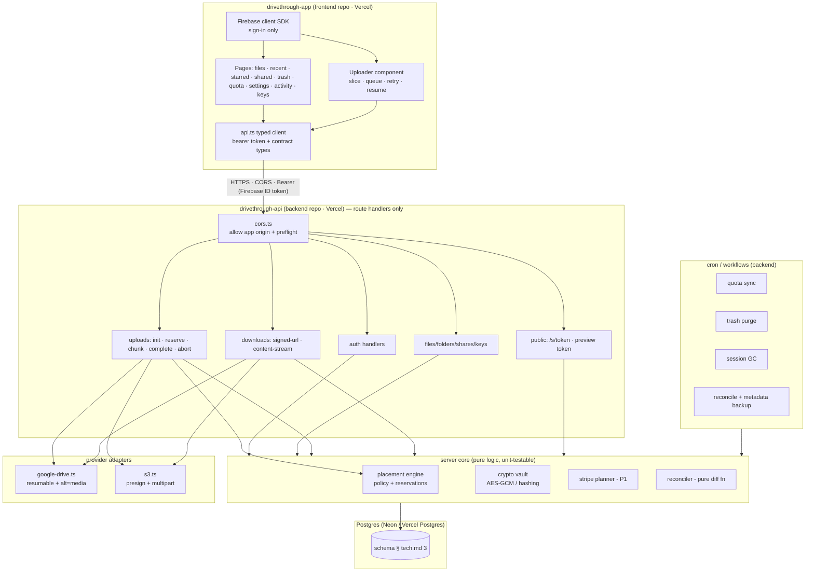

# DriveThrough — Design Document (design.md)

> How the project is designed: architecture, key mechanisms, data design, and the user-facing design.
> Companion docs: [prd.md](./prd.md) · [flow.md](./flow.md) · [tech.md](./tech.md)
> **Build has not started.** Design decisions below are the defaults the build should follow unless a spike contradicts them.

---

## 1. Design philosophy

1. **Metadata is ours; bytes are theirs.** The Postgres namespace (folders, names, stars, shares) is the product. Providers are dumb byte stores addressed by `(account, objectId)`. Everything cheap — move, rename, organize — is a metadata write; no bytes move.
2. **The function is a switchboard, not a warehouse.** Vercel handlers route, authorize, sign, and stream. They never hold a whole file in memory or return > 4.5 MB non-streamed (prd R1–R4).
3. **Durable by construction.** Every long operation is a DB state machine (`uploads` + `upload_chunks`) that survives tab kills, function timeouts, and deploys. The client is a dumb executor that can always ask "where were we?".
4. **Fail loudly, resume silently.** Errors are stable codes with actionable UI (e.g. show per-account free space when placement fails); retries are automatic and idempotent.
5. **Security defaults that 9Drive got backwards, fixed.** Private by default, read-only shares, expiring tokens, hashed secrets, encrypted provider credentials.
6. **ACID for files.** Every operation is atomic, non-blocking, idempotent, and never leaves a file in limbo (guarantees G1–G9 in prd.md §5.4, mechanisms in tech.md §3). "A file got stuck / two ops blocked each other / a retry duplicated data" are bug classes the design treats as cardinal sins.

---

## 2. Architecture

### 2.1 Component view



The frontend repo contains **no SQL, no provider SDK, no secrets** — only pages, the uploader, and `api.ts`. Every call crosses the CORS boundary as `Authorization: Bearer <id-token>` (no cookies → CSRF-immune).

### 2.2 Why this shape (vs 9Drive's)

| 9Drive (Express monolith) | DriveThrough | Reason |
|---|---|---|
| One long-lived server, `req.pipe(busboy)` streaming | Stateless route handlers + DB state machine | Vercel has no long-lived process; R4 |
| In-memory `reservedBytesByAccount` map | `reservations` rows + `FOR UPDATE` | multi-instance correctness (L4) |
| Whole file buffered then uploaded | per-chunk stream pass-through ≤ 4 MB | R1/R2, 2 GB memory cap (L2) |
| MySQL via Prisma | Postgres via driver adapter | serverless connections (L5) |
| Express routers mounted in `app.ts` | file-system routing (App Router) | convention of the platform; less glue |
| `update.sh` from Settings UI | git-push deploy, no shell-out | removes L7 entirely |
| Files physically world-`writer` | private; shares opt-in read-only | fixes L6 |

### 2.3 Layering rule (enforced in review)

**Inside the backend repo**, the only dependency direction is:
```
app/api/** (HTTP, CORS, auth, validation, status codes)
  → server/uploads|downloads|storage (use-cases, transactions)
    → server/providers (external I/O) + server/db (persistence)
      → server/core utilities (crypto, errors, audit)
```
Route handlers contain no SQL and no provider SDK calls directly — all go through use-case services, so the same logic serves API routes, cron jobs, and `/api/v1`.

**Across the repo boundary**, the frontend depends on the backend *only* through the `contracts` types + `api.ts`. It must never import from the backend's `server/**`, and the backend must never import from the frontend. This is what keeps the two deployables independent — one git repo, but two Vercel projects that build, deploy, and scale separately — and the frontend freely alterable.

---

## 3. Key mechanism designs

### 3.1 Upload state machine & chunk ledger (resumability core)

```
uploads:    initiated → reserving → uploading → finalizing → completed
                    ↘      failed ←——————————————/        ↘ aborted
upload_chunks(upload_id, index) ∈ {uploading, committed}   ← source of truth for offsets
reservations(bytes, expires_at)                            ← released on complete/abort/GC
```

- **Authoritative offset** = last contiguous `committed` index (server-side), *verified against provider* (`308 range` for Drive / `ListParts` for S3) whenever the client resumes after a gap or the session is older than N minutes. Provider wins on conflict (it holds the bytes).
- **Idempotency:** `PUT chunk?index=i` is safe to replay: if row already `committed` at the same byte range → return current offset without re-sending upstream; if provider already has it → adopt. Client retries therefore can't double-write.
- **Ordering:** chunk *i* accepted only when all `< i` are committed **or** explicitly marked skipped (out-of-order PUTs get `CHUNK_OUT_OF_ORDER` + the correct next index — cheap signal, keeps the ledger contiguous and the resume math trivial). Drive/S3 both require ordered appends anyway.
- **Finalize:** `complete` runs one transaction: verify `committedBytes == declared size` → insert `files` (+ `file_stripes` P1) → `uploads.status=completed` → `used_bytes += n`, `reserved_bytes -= n` → enqueue quota sync. Any check fails → `failed` + reservation released + provider abort best-effort.
- **GC:** jobs kill sessions idle > 48 h (release reservation, abort provider session). Reservations also carry `expires_at` as a belt-and-braces leak guard.

### 3.2 Placement engine

```
input:  userId, sizeBytes, folderPin?, policy, existing reservations
step 1  candidates := accounts(status=connected) ∩ (available − reserved ≥ size)
step 2  if folderPin ∈ candidates → choose it (subtree stays put)
step 3  apply policy:
          most_available → max(available)          [unknown-quota S3 ranked first, 9Drive parity]
          round_robin    → cursor % candidates     [cursor++ in same txn]
          priority       → user's ordering
step 4  reserve (INSERT reservations, UPDATE storage_usage.reserved_bytes) in ONE transaction
output: accountId (+ root folder / begins provider upload session)
```
Properties: deterministic under concurrency (row lock), testable without providers (pure function over rows), extensible to scoring (P2: cost/latency weights) without changing call sites.

### 3.3 Read paths

| Provider | Small file / preview | Large download |
|---|---|---|
| S3-compatible | 302 presigned GET (≤ 5 min) | 302 presigned GET — **zero Vercel egress** |
| Google Drive | streamed Range proxy (206 pass-through, `no-store`) | streamed Range proxy with `maxDuration` budget; above-plan-size → fallback menu: "chunked browser fetch" (client Range loop → File) or "open in Drive" |

Preview tokens: 10-min TTL, hashed, bound to (file, user) or (file, share) — one code path (`read service + permission resolver`), two issuers.

### 3.4 P1 striping (true combined pool)

- Upload planner splits the file into fixed **64 MB stripes** (chosen: aligned to S3 multipart parts, small enough to place anywhere, large enough that per-stripe overhead ~0.1 %). Each stripe → one `file_stripes` row with its own `account_id` + `provider_object_id`.
- Placement runs **per stripe** with per-account watermarks ⇒ one file can span N accounts; the reservation is the sum.
- Read planner concatenates stripes in index order into a single outgoing stream with correct `Content-Length`; Range requests are translated to (stripe, localOffset) math.
- Failure policy: a failed stripe marks the file `degraded` (readable if parity exists — P2 erasure coding adds `k+m`); reconciler detects missing stripes.
- Tradeoff accepted: 64 MB granularity means a corrupt/lost stripe loses 64 MB, not the file (vs erasure coding which survives it — hence P2).

### 3.5 Dedup (P1, whole-file)

`files.checksum_sha256` (computed incrementally client-side during upload) + unique index `(user_id, checksum_sha256)` where status=active → duplicate upload short-circuits at `complete`: new namespace row points at existing `(account, objectId)`; `used_bytes` grows by 0. Ref-count table handles delete (delete row only when refcount hits 0).

### 3.6 Reconciliation (truth repair)

Pure function `diff(dbRows, providerObjects) → {create, update, delete, adopt}` run by cron in idempotent batches with a pagination checkpoint:
- provider object w/o DB row → **adopt** (default) or quarantine list
- DB row w/o provider object → mark `deleted` (user sees it in Trash, can purge)
- size mismatch → provider wins
- renamed only in DB → rename pushed lazily to provider (Drive) or left as metadata-only truth (S3) — policy per provider documented in the adapter.

---

## 4. Data design highlights (beyond tech.md §3)

- **UUID PKs everywhere** (`uuid v4` via app, not sequential) — safe to expose in URLs, no enumeration, matches 9Drive's `Char(36)` ported to native `uuid`.
- **Soft delete + purge** as two distinct states → trash is a view, purge is the only provider delete (except API-key-scoped "immediate").
- **jsonb for the variable bits:** `invites`, `api_keys.scopes`, `audit_logs.metadata`, `uploads.stripe_plan` — avoid table sprawl.
- **Money fields:** all sizes `bigint` (bytes); conversions to human strings happen client-side only (9Drive rule: bigint → string before JSON, kept).
- **Invariant checks** in a nightly job: `used_bytes` recount per account; drift → auto-repair + audit entry.

---

## 5. UX / Interface design

### 5.1 Information architecture

```
/sign-in · /sign-up                     ← public
/files?folderId=…&q=…                   ← main browser (list/grid, breadcrumb, search)
/recent · /starred · /shared · /trash    ← smart views
/quota                                   ← combined storage + per-account cards + sync controls
/activity                                ← audit timeline
/keys                                    ← API keys (secret shown once, copy affordance)
/settings                                ← accounts (connect/disconnect/reauth), upload routing policy,
                                           danger zone, diagnostics/health
/s/[token]                               ← public share page (preview + download, no chrome)
/api/…                                   ← JSON API + /api/v1 (key-auth docs page in-app, 9Drive parity)
```

### 5.2 Screen design — main file browser (the product's center of gravity)

```
┌──────────────────────────────────────────────────────────────────────────┐
│ ◧ DriveThrough    [🔍 search files……]        [⬆ Upload]  [⋯]  (avatar)  │
├───────────────┬──────────────────────────────────────────────────────────┤
│ 📁 All Files  │  All Files › Project X › Renders          [grid|list] ▮  │
│ ⏱ Recent      │ ┌────────────────────────────────────────────────────┐   │
│ ★ Starred     │ │ 📁 Renders     📁 Source      ▶️ out_final.mp4     │   │
│ 🔗 Shared     │ │ 📄 brief.pdf   🖼 hero.png    📦 backup_2026.zip   │   │
│ 🗑 Trash      │ │                                                    │   │
│ ─────────     │ └────────────────────────────────────────────────────┘   │
│ 💾 Storage    │  ↑ rows: name · size · modified · provider chip (G/B/S3)│
│ ▓▓▓▓▓░░ 62%  │    hover: preview · download · ⋯ (rename/move/share/    │
│ 3 accounts    │    star/delete)   · right-click = context menu          │
│ [Manage]      │                                                          │
│ ─────────     │  Selection bar: move · download · share · delete        │
│ Activity Keys │                                                          │
│ Settings      │  ┌ upload dock (bottom-right, persists across pages) ┐  │
└───────────────┘  │ ▶ renders.mp4  ███████░░░ 72%  41 MB/s   ⏸  ✕   │  │
                   └───────────────────────────────────────────────────┘  │
```

Design decisions:
- **Chrome & settings (2026-10-22 restyle)** — every surface is a Win98-modernized window (beveled frame + navy gradient title bar; §5.3). The sidebar's bottom row is the user card with the **⚙ button, which opens Settings — Connections as a draggable window**: Google Drive accounts (connect / quota+sync / disconnect) + the OAuth-credentials form. `/settings` survives as a route because Google's OAuth callback 302s there — it renders the same panel (one component, two homes). The browser itself is details-view (Name · Size · Type · Modified · Drv chip), sortable columns, navy row selection, right-click context menus, drag-and-drop upload target, inline rename (F2), move-to folder-tree dialog.
- **Provider chip per row** — honest about where bytes live (a small `G` / `R2` / `B2` badge), hover shows exact account + free space. The pool is virtual; hiding placement entirely breeds confusion when an account dies.
- **Upload dock** — bottom-right stacked cards (9Drive's progress panel, kept): per-file progress, pause/resume/cancel, aggregate speed; survives navigation (component at layout level); on resume-after-reload it re-attaches to server sessions automatically.
- **Placement-failure state** — instead of a bare error, a panel: per-account free bars + "Free up space" / "Choose account" / (P1) "Split across accounts automatically".
- **Trash-first deletion** — delete is always soft; permanent delete lives only in Trash view.
- **Empty/loading/error triad** per view with skeletons (not spinners) for lists.

### 5.3 Visual language (design tokens)

> **Restyled 2026-10-22 (owner brief: "beautiful retro file explorer, animated, settings at the side"): "Windows 98, modernized", applied to the WHOLE app** (sign-in, explorer, connections, trash, activity, share page — share page keeps minimal chrome). Presented four directions (Win98 / CRT phosphor / Y2K-vaporwave / System 7); owner picked Win98 modernized. "Modernized" = authentic Win98 geometry rendered with AA-contrast inks, crisp modern type and a 120–180 ms motion budget — a real tool, not a costume.

| Token | Value | Rationale |
|---|---|---|
| Theme | one world (no dark/light flip): teal desktop `#0d7b76` + 4% 45° dither, silver faces `#c8c8c8`, field face `#ffffff`, title gradients `#000080 → #1084d0` | the retro frame is the product identity |
| Geometry | radius **0** everywhere; bevels (raised / pressed / thin / sunken) as pure `box-shadow` insets, 1 px light + 1 px dark + 2 px mid ramp | Win98 authenticity, DPR-safe, zero image assets |
| Ink | `#141414` near-black (never pure black), soft `#4a4a4a`, faint `#6f6f6f` — all ≥ 4.5:1 on face | AA contrast held inside the retro frame |
| Selection | row select + text `::selection` = title-bar navy `#000080` + white | authentic and instantly recognizable |
| Type | `Tahoma → Segoe UI → Verdana → system-ui`; `Courier New` for previews; tabular-nums for sizes/quota | carries the Win98 voice on every platform, degrades gracefully, no webfont dependency |
| Density | root 14 px, rows 28 px, controls 24/32 px, window title bar 26 px | Win98 density, modernized |
| Semantic | free/ok `#0f6d0f`, warn/reserved `#8a5200`, error `#a40000` | quota bars + status text read at a glance |
| Motion | 120–180 ms ease-out: windows bloom (fade + 6 px rise + 0.985 scale), menus pop from their corner, progress = segmented navy blocks (+ Win95 marquee when indeterminate), buttons swap bevel on press, sidebar drawer slides | "modernized" half of the brief — buttery everywhere, instant only where Win98 was instant (bevel swap, selection) |
| Iconography | hand-drawn 16×16 pixel SVG set, `shape-rendering="crispEdges"` (yellow folders, mime-typed files) | consistent chunk, no icon dependency |
| Focus | 1 px dotted outline, offset inward (Win98 style) | authentic + keyboard accessible |
| Scrollbars | 16 px bars, dithered track, beveled thumb | detail depth |
| Reduced motion | every animation + transition collapses under `prefers-reduced-motion` | accessibility |

Conventions: Tailwind 4 `@theme` tokens for the above; shared primitives in `components/retro/` — `RetroWindow` (beveled frame, gradient title bar, drag-by-title), `RetroButton`/`RetroInput`/`RetroProgress`, `RetroMenu` (context menu), `RetroDialog`/`ConfirmDialog` (replaces native `confirm()`/`prompt()`); keyboard unchanged (`↑↓ Enter Del F2` rename, `/` search, `Esc` clear); context menu on right-click; touch targets ≥ 40 px; WCAG AA contrast throughout.

### 5.4 Responsive strategy

Mobile-first sheets: sidebar → slide-over drawer; grid columns 2 → 4 → 6; upload dock collapses to a pill with expandable list; share page is minimal-chrome and thumb-friendly (large Download button, inline video). PWA manifest + service worker (P1): installable, offline queue for uploads (chunks retry when back online).

### 5.5 Public share page (`/s/[token]`)

Minimal: file name, size, mime, provider-agnostic preview (image inline / video element streaming from the same Range proxy / PDF embed / text), Download button, "shared by DriveThrough" footer, expiry countdown if set, dead-link state ("This link has been revoked"). No app chrome, no account requirement, rate-limited per IP.

### 5.6 Settings / Quota screens

- **Quota:** combined hero number + stacked bar; per-account cards: name/email, provider badge, used/total, reserved, last sync (+ manual "Sync now" with cooldown), status (`connected/needs_reauth/disabled`), disconnect (confirm dialog naming dependent files).
- **Routing policy:** three-option segmented control (`most_available | round_robin | priority`) with plain-language descriptions + drag-order list when `priority` selected (9Drive parity).
- **Accounts:** Google OAuth credentials card (client ID / secret / redirect URI with Copy — 9Drive parity: configured **in-app**, stored encrypted, secret write-only via `hasSecret`) gating the Connect button; S3 modal with endpoint/bucket/keys + "Test connection" + endpoint SSRF warning note.
- **Diagnostics:** health card (DB, last cron runs, per-account last error) — from `/api/health`.

---

## 6. Error taxonomy → UX mapping

| Code | Shown as |
|---|---|
| `NO_ACCOUNT_WITH_ENOUGH_SPACE` | placement panel (per-account bars + actions) |
| `ACCOUNT_NEEDS_REAUTH` | banner on account card + "Reconnect" (Google re-consent) |
| `UPLOAD_SIZE_MISMATCH` / `CHUNK_OUT_OF_ORDER` | auto-retry once → then "Resume" button |
| `RATE_LIMITED` | dock note "slowing down…" with retry countdown; on the public share page → dead-link card "Too many requests" |
| `SHARE_NOT_FOUND` / `SHARE_EXPIRED` / `PREVIEW_TOKEN_INVALID` | share page / preview window → dead-link card ("This link has been revoked" / "This link has expired") — same 404 wording for revoked, expired, trashed and purged, so the page leaks nothing about why |
| `TOKEN_REVOKED` | keys view: the row simply shows "revoked"; scripts get the honest 401 on their next call |
| `FILE_TOO_LARGE_FOR_PLAN` | explain + options (split / upgrade / direct link) |
| `UPSTREAM_QUOTA_EXCEEDED` (Google 750 GB/day) | "Account at daily upload limit — retry in X h" with per-account attribution |
| `UNAUTHENTICATED` | soft redirect preserving return URL |
| `SERVICE_NOT_CONFIGURED` | settings inline notice — "Google Drive connect isn't configured on this server yet (missing …)". A 503 with an honest message, **never a raw 500**; the connect button then waits for admin setup instead of crashing. Connect-failure diagnosis (added 2026-10-22, caught live): the callback logs the step/status detail server-side and passes it to the settings banner as `?detail=` — charset-filtered via `safeDetail` (allow-list + 120-char cap; status codes and Google's public error names only, **never secrets**, never URL-reshapable) |

---

## 7. Security design summary (detail in tech.md §8)

Threat model focus: leaked links, stolen DB, stolen tokens, malicious uploads, SSRF via S3 endpoint, quota abuse via API keys.  
Controls: Firebase ID-token verification (short TTL ≤1 h — which doubles as the revocation bound, since keyless verify can't check revocation; see §8); hashed bearer secrets; AES-GCM vault with AAD binding; read-only/expiring shares (revocation immediate by hash lookup); per-route rate limits; no credentialed URL ever returned across users; SSRF allowlist on endpoints; audit trail for every sensitive action; guard tests forbidding `role:'writer'` public permissions and full-body buffering.

---

## 8. Design tradeoffs made (and rejected alternatives)

| Decision | Chosen | Rejected | Why |
|---|---|---|---|
| App framework | Next.js in **one monorepo, two deployables** (api = route-handlers-only, app = pages; two Vercel projects via Root Directory) + shared `contracts` npm workspace (owner decisions 2026-10-20: separate deployables; same day, monorepo git hosting) | one Next.js app (true monolith); 9Drive-style separate Express + Vite; three fully-separate git repos | keeps frontend independently deployable & freely alterable (owner's explicit requirement) without 9Drive's long-lived-server problem — both halves are still Vercel serverless. Cost accepted: cross-origin CORS + bearer-only auth + contract-sync discipline |
| Chunk transport | raw `Content-Range` PUT bodies | multipart/form-data (9Drive) | no framing overhead, exact 4 MB math, simpler idempotency |
| Drive read | server Range proxy | make-all-files-public direct links | privacy (L6 fix) at cost of egress — revisited per-file via share opt-in |
| S3 read | presigned 302 | proxy | zero egress cost, better throughput |
| Namespace | virtual folders, metadata-only | mirror hierarchy into Drive folders | O(1) moves, cross-account moves, no provider rename quota burn |
| Placement state | DB reservations | in-memory map (9Drive) | serverless multi-instance (L4) |
| Big files (v1) | honest single-account limit **with a promotion criterion** | ship striping day 1 unconditionally | striping is P1 — protocol stays identical, `stripe_plan` field ready. **Rule (prd.md §11): if the owner's biggest file > biggest account's free space, promote whole-chunk striping to P0.6** (reuses chunk pipeline; rclone `chunker` = proven open design to port) |
| Byte relay for Drive | measure first: Vercel proxy (S1-A), free Cloudflare Worker relay (S1-B) | paid proxy/VPS, public direct links | Worker free tier = no response-size cap + no wall-clock cap while connected + 100 k req/day ⇒ big downloads at **$0** and ≈0 Vercel bandwidth (prd.md §11); cost: one extra deploy surface + short-lived HMAC relay tickets |
| Dedup | P1 whole-file, P2 CDC | day-1 FastCDC | CDC needs chunk-level storage model; premature before striping exists |
| DB | Postgres (Neon/Vercel) | MySQL (9Drive), SQLite/Turso | relational + jsonb + Prisma adapters + marketplace integration; Turso viable fallback |
| Auth | **Firebase Auth** (owner's choice) | Better Auth, NextAuth (legacy), Clerk, roll-your-own | sign-in only — Google+email/password UX for free, no password/session code in our DB, free tier ample; cost: split identity store (Firebase = who, Postgres = what) + server-side ID-token verification. Better Auth = fallback if self-hosted identity becomes a requirement |
| ID-token verification | **Keyless**: `jose` + Google's public JWKS (signature + iss/aud/exp/sub per Google's manual checklist); `firebase-admin` dropped 2026-10-20 | `firebase-admin` + service-account JSON (impossible here: org policy `iam.disableServiceAccountKeyCreation`, "secure by default" enforcement); workload-identity federation (overkill — JWT verification fundamentally needs no credential) | no secret to store/rotate, org-policy-proof, much lighter dependency (faster cold starts); **cost accepted: no `checkRevoked`** — sensitive ops (disconnect, purge, key create) are bounded by the token's ≤1 h TTL as revocation bound; revisit only if instant global sign-out becomes a requirement |
| Visual language | **"Windows 98, modernized", whole app** (owner brief 2026-10-22): teal dithered desktop, beveled silver windows with draggable title bars, navy gradient title bars, Tahoma stack, hand-drawn pixel SVG icons, 120–180 ms motion | the original modern-dark spec (indigo accent, 10 px radius, lucide); CRT/phosphor; Y2K-vaporwave; System 7 (all four were presented; owner chose Win98) | retro file-explorer is the owner's product identity for v1; "modernized" keeps AA contrast, tabular numerals, keyboard affordances and the motion budget so it stays a real tool; cost accepted: no dark/light flip (single world), custom primitives instead of a component library |

---

## 9. Design-phase exit checklist (before build)

- [x] Research complete (prd.md) — inspiration anatomy, platform limits, competition, algorithms
- [x] Flows defined (flow.md) — control/write/read planes, state machines, jobs, acceptance scenarios
- [x] Technical requirements fixed (tech.md) — stack, schema, APIs, security, tests, phases, spikes S1–S6
- [x] Design fixed (design.md) — architecture, mechanisms, UX/IA, tokens, error taxonomy, tradeoffs
- [x] Skills installed & integrated (`.opencode/skills/`, `opencode.jsonc`, `AGENTS.md`)
- [ ] User review of all four docs → then **build may start** (per project instruction: nothing built until this point)
