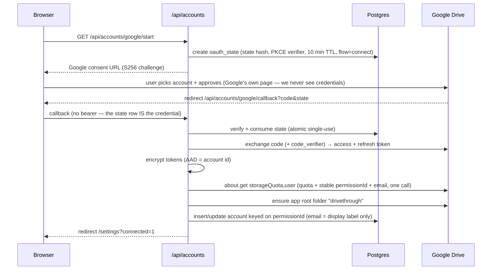
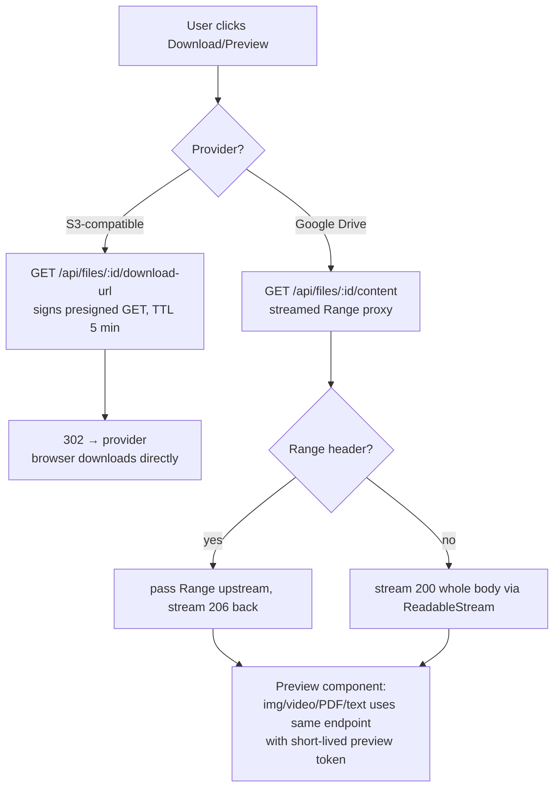
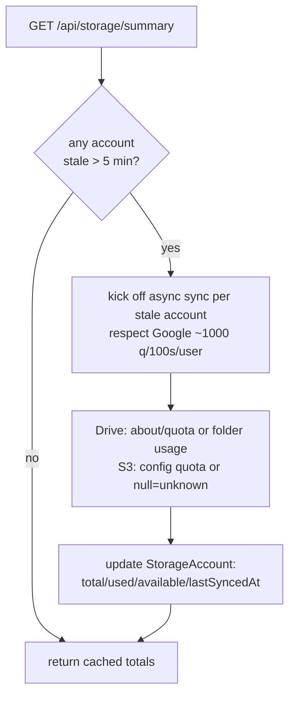

# DriveThrough — System Flow (flow.md)

> How the system works end-to-end: every request path, state machine, and background loop.
> Companion docs: [prd.md](./prd.md) · [tech.md](./tech.md) · [design.md](./design.md)
> **Build has not started** — this is the flow the build will implement.

---

## 1. The big picture

```mermaid
flowchart LR
    subgraph Client["Browser (any device)"]
        UL[Chunk Uploader<br/>slices files ≤4MB]
    end

    subgraph AppVercel["Vercel — drivethrough-app (frontend)"]
        UI[Next.js UI<br/>pages + api.ts client]
    end

    subgraph ApiVercel["Vercel — drivethrough-api (backend)"]
        RW[Route Handlers<br/>auth · metadata · chunk proxy]
        CRON[Cron / Workflow<br/>quota sync · purge · reconcile · backup]
    end

    subgraph Data["Data layer"]
        PG[(Postgres<br/>Neon/Vercel Postgres)]
    end

    subgraph Providers["User's connected storage"]
        GD1[Google Drive A]
        GD2[Google Drive B]
        S3[S3-compatible<br/>R2 / B2 / Wasabi / MinIO]
    end

    UI -->|Bearer ID token · CORS| RW
    UL -->|POST/PUT chunk ≤4.5MB · Bearer| RW
    RW --> PG
    CRON --> PG
    RW -->|chunk stream proxied| GD1
    RW -->|chunk stream proxied| GD2
    UL -.->|presigned PUT (direct)| S3
    UI -->|302 presigned GET| S3
    UI -->|streamed Range proxy| RW
```

**Three flow classes:**

| Class | Bytes path | Used for |
|---|---|---|
| **Control plane** | client ↔ Vercel (JSON, always < 4.5 MB) | auth, listings, folder ops, quota, share, API keys |
| **Write plane** | client → Vercel → provider (chunk ≤ 4 MB) for Drive; client → provider direct (presigned) for S3 | uploads |
| **Read plane** | client → 302 → provider (S3 presigned); client → Vercel streamed Range proxy → provider (Drive) | download, preview |

Rule R1–R4 from prd.md §4 govern all three: nothing over 4.5 MB is ever buffered by a function.

---

## 2. Identity flow (Firebase Authentication)

**Firebase Auth = the ID desk at the entrance.** It proves *who you are* (Google popup or email/password) and hands the browser a short-lived **ID token**. Our code never sees or stores passwords.

```mermaid
sequenceDiagram
    participant B as Browser (Firebase SDK)
    participant F as Firebase Auth (Google)
    participant A as Route Handler
    participant P as Postgres

    B->>F: signInWithPopup(Google) or email/password
    F-->>B: ID token (≈1 h, SDK auto-refreshes)
    B->>A: API call + Authorization: Bearer <ID token>
    A->>A: verify ID token (keyless: jose + Google public JWKS)
    A->>P: upsert users row keyed by firebase_uid (first call only)
    A-->>B: data (Bearer-only — cross-origin, no session cookie)
    Note over A: no password table, no session table —<br/>Firebase owns credentials; we trust only verified tokens
```

- **Sign-in ≠ connect a Drive account.** Firebase only answers "who is this?". Connecting N Drive accounts (and getting `drive` scope refresh tokens) is our **own server-side OAuth flow**, started from Settings — unchanged from the diagram below.
- Drive refresh tokens are stored encrypted (`TOKEN_ENCRYPTION_KEY`, AES-256-GCM); share/preview/API-key tokens stored as hashes (9Drive convention, kept).
- Every protected route: verify the ID token → derive `firebase_uid` → map to our `users` row. Token is short-lived, so stolen-token windows are small; revocation-sensitive actions (connect/disconnect account, purge) additionally check revocation status.

---

## 3. Connect a storage account (write path into the pool)



S3 accounts skip OAuth: the browser posts endpoint/region/bucket/keys/prefix; server validates with a test `HeadBucket`/`ListObjects` call, encrypts keys, inserts rows.

**Config source:** the flow resolves the app's Google OAuth client credentials from `provider_configs` — the Settings form (9Drive parity, adopted 2026-10-21 after owner review) — with the `GOOGLE_*` env vars as a local-dev fallback; missing everywhere ⇒ the honest 503 `SERVICE_NOT_CONFIGURED`.

**App root folder:** per connected account the server ensures a single root folder (named `drivethrough`) and stores its provider ID — all physical objects live beneath it; the virtual namespace is independent (9Drive's model, kept).

---

## 4. Upload flow (the critical path)

### 4.1 State machine (`UploadSession`)

```
initiated ──► uploading ──► finalizing ──► completed
    │             │             │
    │             ▼             ▼
    └────────► failed ◄────── aborted
                 │
                 └──(client retry)──► initiated
```

### 4.2 Sequence — chunked resumable upload

```mermaid
sequenceDiagram
    participant B as Browser uploader
    participant A as POST /api/uploads/init
    participant R as POST /api/uploads/reserve
    participant C as PUT /api/uploads/chunk/:id
    participant F as POST /api/uploads/:id/complete
    participant P as Postgres
    participant GD as Google Drive

    B->>A: {name, size, mime, folderId, chunkSize, totalChunks}
    A->>A: validate size ≤ MAX, mime allowlist
    A->>P: INSERT upload_session (initiated)
    A-->>B: {sessionId, provider, chunkSize, alreadyUploaded: 0}

    Note over B,R: Placement decision (once per file)
    B->>R: POST /api/uploads/reserve {sessionId, size}
    R->>P: BEGIN; pick eligible account (most_available/round_robin/priority)<br/>accounting existing reservations FOR UPDATE; INSERT reservation; COMMIT
    R-->>B: {accountId, targetFolderId, googleSessionUri?}
    Note over R,GD: For Drive: server initiates resumable session,<br/>stores session URI on the upload_session row (308 protocol)

    loop each chunk i (parallelism ≤3, order preserved per stripe)
        B->>C: PUT chunk i (Content-Range: bytes a-b/total, ≤4.5MB body)
        C->>P: claim chunk i (idempotent upsert, status=uploading)
        C->>GD: PUT to googleSessionUri (streamed request body → upstream)
        GD-->>C: 308 (more) / 200 (last chunk, returns file id)
        C-->>B: {offset, nextChunk, chunkDone: true}
    end

    B->>F: POST /api/uploads/:id/complete
    F->>P: verify all chunks committed; INSERT file row; mark session completed;<br/>release reservation; add usage
    F-->>B: {file}

    Note over B,GD: Client dies mid-way? Session + chunk table survive.<br/>On reload: GET /api/uploads/:id → status + committed offset → resume from next chunk.<br/>Server re-queries provider offset (308 range check) if DB and provider disagree.
```

**S3 variant:** at `reserve` time the server returns either presigned part URLs (client uploads parts **directly to S3 — zero Vercel egress**, ideal) or, if the provider forbids browser-direct (no CORS), the same chunk-proxy path as Drive. `complete` calls `CompleteMultipartUpload`.

### 4.3 Upload flow rules

1. **Reservation before first byte** — prevents two parallel uploads picking the same last free GB (fixes 9Drive's in-memory L4 with a DB row + `FOR UPDATE`).
2. **Chunk idempotency** — retrying chunk *i* is safe (upsert by `(sessionId, index)`; re-send to provider only if provider offset says it's missing).
3. **Byte accounting** — declared size vs actually-streamed bytes are compared at `complete` (9Drive's `UPLOAD_SIZE_MISMATCH` guard, kept).
4. **Failure** — any unrecoverable provider error → session `failed` + reservation released; client surfaces retry button; stale sessions GC'd after 48 h (orphan chunk cleanup).
5. **Quota refresh** — after `complete`, enqueue async quota sync for the touched account (never inline in the response).

---

## 5. Read flows

### 5.1 List / navigate (control plane)

```
GET /api/files?folderId=&q=&sort=
 → session auth → SQL (indexed: userId+status+folderId+createdAt)
 → JSON rows (< 4.5MB for any realistic page; paginate at 100)
```
Search = Postgres full-text / trigram on `name` (per user), P0 simple `ILIKE` → P1 FTS index.

### 5.2 Download & preview



- **Drive downloads go through Vercel as a stream** (allowed: streaming functions have no 4.5 MB cap) with `maxDuration` chosen per file size; a config guard refuses (or chunks) files above a threshold on Hobby.
- **Preview tokens**: `POST /api/files/:id/preview-token` → hashed, 10 min TTL → `/api/preview/[token]` works unauthenticated for the duration (same pattern as 9Drive, kept).
- **Public share page**: `/s/[token]` → same read flow, permission checked against `FileShare` (enabled, not expired). Default role is read-only (fixes 9Drive's world-`writer` L6).

---

## 6. Metadata flows (folder & file management)

All are control-plane JSON ops; each writes an audit row.

| Action | Flow |
|---|---|
| Create folder | insert `Folder` row (parentId, virtual only — no provider call) |
| Rename file | update DB name **only** (physical name untouched; avoids provider rename quota/latency) — provider name updated lazily by reconciler |
| Move | validate no cycles → update `folderId` in txn (virtual move = O(1), instant, even cross-account) |
| Delete | soft delete: `status=deleted, deletedAt=now` (immediately invisible, restorable) |
| Restore | clear `deletedAt` |
| Purge (manual or cron >30 d) | delete on provider (Drive `files.delete` → trash; S3 `DeleteObject`) → mark `purged`; release usage |
| Star / recent | derived views over existing indexes |

**Why virtual-only folders beat 9Drive's hybrid:** moving a 500 GB file between "folders" (or between accounts) becomes a metadata update — no bytes move. Physical placement is an implementation detail of the file row, not the folder tree.

---

## 7. Quota & placement flow



**Placement (per upload reservation):**
1. Candidates = connected accounts, status ok, `available − reserved ≥ size` (null available = "unknown → eligible last").
2. Apply policy: `priority` → user's order; `round_robin` → cursor (atomic increment in txn); `most_available` → max free bytes (S3-without-quota ranked first, as 9Drive does).
3. Folder pin: if target virtual folder has a pinned `connectedAccountId`, restrict candidates (keeps a subtree on one account when the user wants that).
4. Reserve in the same transaction; on exhaustion → `NO_ACCOUNT_WITH_ENOUGH_SPACE` with a UI panel showing per-account free space (and, P1, offer striping).

---

## 8. Background flows (cron / Vercel Workflows — no long-lived process)

| Job | Trigger | Steps | Failure handling |
|---|---|---|---|
| **Quota sync** | cron 10 min + after uploads | refresh stale `StorageAccount` rows | per-account error column, exponential backoff, skip on 403 (revoked) → mark account `needs_reauth` |
| **Trash purge** | daily | soft-deleted > 30 d → provider delete → `purged` | idempotent; skip missing objects |
| **Reconcile ("Sync Drive")** | daily + manual button | list provider app-root recursively → create missing file rows, update changed sizes, mark vanished as deleted (or purge), detect out-of-band renames | batched pagination, checkpoint row so partial runs resume |
| **Upload session GC** | hourly | `initiated/uploading` older than 48 h → `failed`, release reservations, abort provider session (Drive: send PUT with `Content-Range: */total` to kill session; S3: AbortMultipartUpload) | idempotent |
| **Orphan check** | weekly | provider objects with no DB row → adopt or delete per config | safe default: adopt |
| **Session/token cleanup** | daily | expired sessions, used oauth states, expired preview tokens, revoked API keys | — |
| **Metadata backup** | daily | `pg_dump -Fc` → AES-256-GCM → R2 free tier (offsite); retain 30 daily + 12 monthly | idempotent; failure raises the health-card alarm; weekly backstop via GitHub Actions |

**Hobby-plan reality (verified 2026):** cron triggers at most **once per day** (prd.md §11). Every job above is idempotent and correctness never depends on tick frequency — reservations/sessions expire lazily via `expires_at` at query time, quota sync also fires as a **plain function call after uploads** (event trigger, no cron needed), and a stale GC tick delays cleanup but can never corrupt state (G5).

---

## 9. API surface map (control plane)

Mirrors 9Drive's proven surface, namespaced under `/api`:

```
Auth        Firebase SDK on client (Google + email/password) · every API call carries Authorization: Bearer <ID token> (no session endpoint — cross-origin bearer)
Accounts    GET /api/accounts · GET /api/accounts/google/start → { authUrl } (frontend navigates there; until Google creds exist — Settings form or env — this returns 503 SERVICE_NOT_CONFIGURED with an honest message — never a raw 500, design.md §6)
            GET  /api/accounts/google/callback?code&state (Google redirect → 302 to frontend; no bearer — single-use state is the credential; on failure → 302 `?connect=error&reason=<code>&detail=<sanitized step/status+Google error>` — banner shows it, server logs the same, never secrets)
            POST /api/accounts/:id/sync-quota · DELETE /api/accounts/:id
System      GET/POST /api/system/google-config (9Drive parity: the app's Google OAuth client credentials entered in Settings, stored encrypted; secret WRITE-ONLY — only a hasSecret flag leaves the server)
Storage     GET /api/storage/summary · GET /api/storage/breakdown
Folders     GET/POST /api/folders · PATCH/DELETE /api/folders/:id
Files       GET /api/files · GET/PATCH/DELETE /api/files/:id · POST /api/files/batch
            GET/POST/DELETE /api/files/:id/share        (GET = live-link count, no tokens ever listed · POST = idempotent create via client UUID, 201 fresh / 200 replay with token null, raw `dsh_` token returned ONCE · DELETE = revoke ALL live links, idempotent `{revoked:n}`)
            POST /api/files/:id/preview-token           (mints a 10-min `dtp_` capability for in-app preview)
            GET /api/files/:id/content · /download-url
Public      GET /api/shares/:token                      (share metadata only: name/size/mime/role/expiry — no account/folder internals; 404 SHARE_NOT_FOUND when revoked/expired/trashed/purged)
            GET /api/preview/:token?download=1          (ONE content route, two issuers — preview AND share tokens resolve through the same permission resolver, so revoke lands on the very next request; Range streaming, 404 PREVIEW_TOKEN_INVALID on a dead token)
Uploads     POST /api/uploads/init · POST /api/uploads/reserve
            PUT  /api/uploads/chunk/:id · GET /api/uploads/:id
            POST /api/uploads/:id/complete · POST /api/uploads/:id/abort
Keys        GET/POST /api/keys · DELETE /api/keys/:id   (POST returns the raw `dtk_…` secret ONCE — the list serves key_prefix only; DELETE is the revoke, next key-authenticated call → 401 TOKEN_REVOKED)
Public API  POST /api/v1/uploads (API-key auth ONLY — a session bearer is rejected 401; init+reserve folded into one call)
            GET /api/v1/uploads/:id · PUT /api/v1/uploads/:id/chunk · POST /api/v1/uploads/:id/complete · POST /api/v1/uploads/:id/abort  (mirror of the internal protocol, same no-buffer streaming)
Activity    GET /api/activity
```

Rate limits (in-Postgres fixed-window `rate_limits`, atomic upsert — serverless-safe, no memory counters; `clientIp` = first `x-forwarded-for` entry): auth endpoints 10/min/IP (checked BEFORE token verification), share metadata 60/min/IP, preview content 300/min/IP, internal chunk 600/min/user, `/api/v1` 600/min/key. Over-limit → 429 `RATE_LIMITED`.

Errors: stable JSON `{ code, message }` (9Drive convention kept), e.g. `NO_ACCOUNT_WITH_ENOUGH_SPACE`, `UPLOAD_SIZE_MISMATCH`, `ACCOUNT_NEEDS_REAUTH`, `SHARE_NOT_FOUND`, `SHARE_EXPIRED`, `PREVIEW_TOKEN_INVALID`, `TOKEN_REVOKED`, `RATE_LIMITED`.

---

## 10. End-to-end scenarios (acceptance walkthroughs)

1. **Fresh device:** open URL → Google sign-in → dashboard shows 3 accounts, combined free space → browse folders → open a file preview in < 10 s.
2. **Flaky mobile upload:** 3 GB video, airplane mode at 60 % → reopen → `GET /api/uploads/:id` reports committed offset → resume → completes; quota bar for that account moves; activity log has one row.
3. **Overflow upload:** 80 GB file, largest account has 40 GB → P0: clear error + suggestion UI; P1: striped across 3 accounts → download reassembles transparently (stripe fan-out read: fetch stripes in order, stream out).
4. **Share safely:** create link → open in incognito → preview works → revoke → incognito gets 404 within seconds.
5. **Out-of-band edit:** user deletes a file directly in Drive → tomorrow's reconciler marks it `deleted` in-app → it lands in Trash view.
6. **Key hygiene:** create API key (shown once) → upload via curl script → key appears in Activity with last-used → revoke → next call 401.
7. **Two devices, zero blocking (G3):** phone uploads 3 GB while laptop previews a *different* file on the same account, renames another, and empties Trash — nothing waits on anything. Kill the phone upload mid-way → laptop shows it as "uploading", phone resumes later. A third device's open download of a file that just got deleted keeps streaming (soft delete never breaks an open read), and the file lands restorable in Trash.
